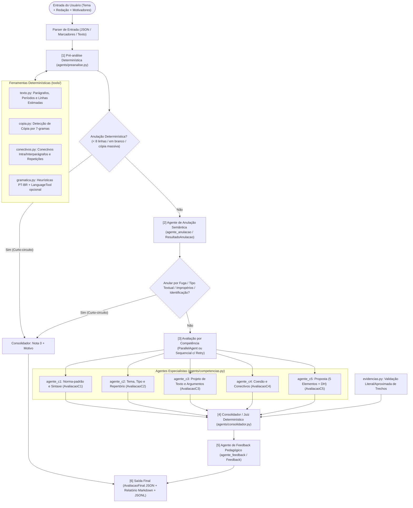
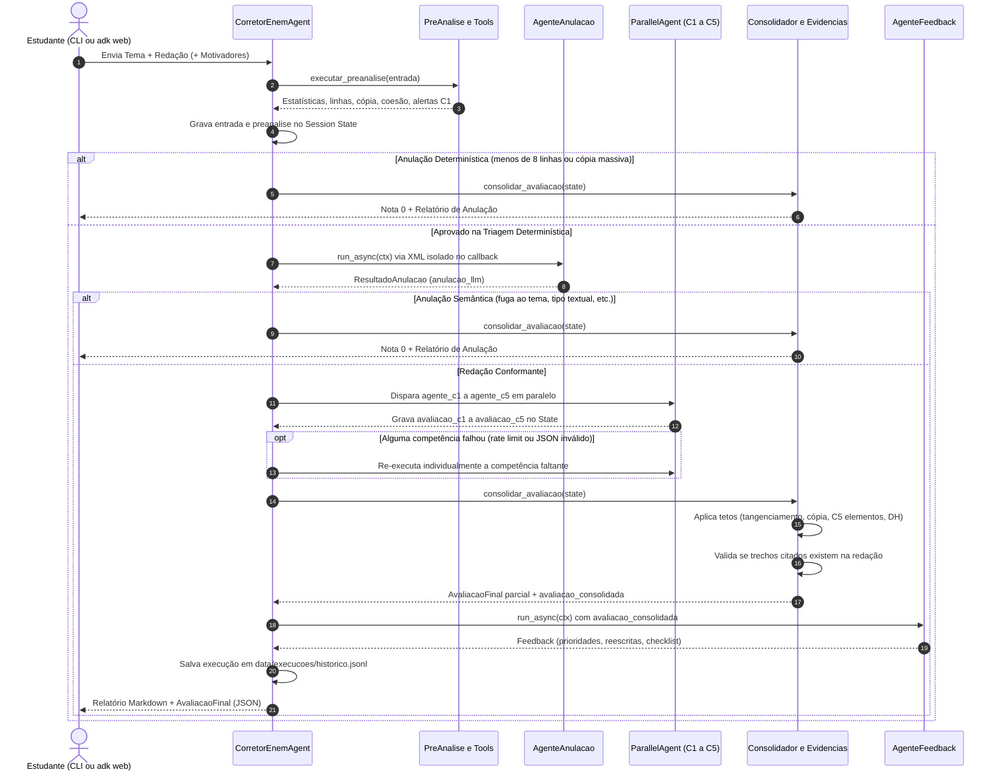
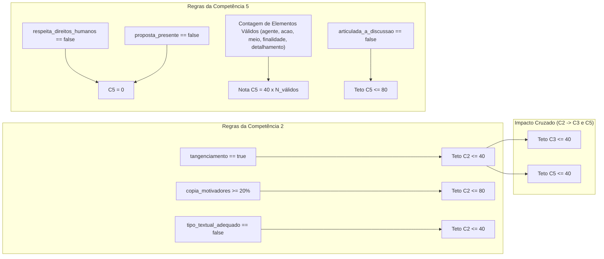
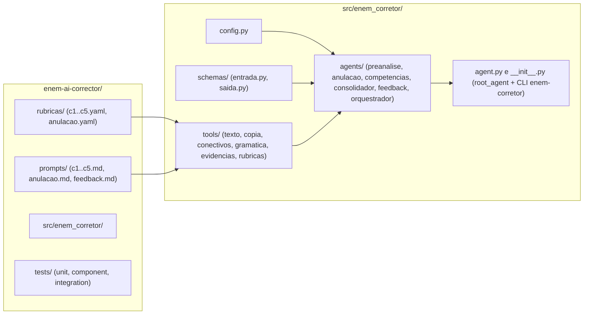

# Corretor de Redação ENEM com Google ADK

Corretor local de redações do ENEM nas **5 competências oficiais (C1 a C5)** construído sobre o **Google ADK (Agent Development Kit)**, schemas estruturados em **Pydantic v2**, ferramentas determinísticas de pré-análise/validação e suporte nativo tanto ao **Gemini Free Tier (Google AI Studio)** quanto a modelos locais via **Ollama / LiteLLM**.

> [!IMPORTANT]
> Este sistema é uma ferramenta de estudo e apoio pedagógico; não substitui corretores humanos nem garante a nota oficial atribuída pelo INEP. As rubricas em `rubricas/*.yaml` trazem `verificado: false` até que você as confira com a Cartilha do Participante do ano vigente.

---

## 1. Visão Geral da Arquitetura

O sistema combina **etapas determinísticas em Python** (para tarefas em que LLMs puros costumam falhar, como contagem exata de linhas, sobreposição de $n$-gramas com textos motivadores, catálogo de conectivos, regras de teto entre competências e verificação literal de citações) com **agentes especializados no Google ADK** (`LlmAgent` e `ParallelAgent`), coordenados pelo orquestrador customizado `CorretorEnemAgent` (`BaseAgent`).



---

## 2. Diagrama de Sequência de Execução

O diagrama abaixo detalha o ciclo de vida de uma correção no `InMemoryRunner` / `adk web`, incluindo o isolamento de contexto via `before_model_callback` (proteção contra *prompt injection* usando delimitadores XML `<tema>`, `<motivadores>`, `<preanalise>` e `<redacao>`).



---

## 3. Regras de Consolidação e Tetos de Nota (Etapa 4)

Mesmo com prompts calibrados, LLMs podem divergir entre o diagnóstico textual e a nota atribuída. O módulo `agents/consolidador.py` aplica deterministicamente as travas oficiais da matriz do ENEM:



---

## 4. Estrutura do Repositório e Módulos



```text
enem-ai-corrector/
├── README.md
├── pyproject.toml
├── .env.example
├── rubricas/
│   ├── c1.yaml … c5.yaml          # Descritores por nível (0..200), orientações e tetos
│   └── anulacao.yaml              # Hipóteses de nota zero (determinísticas e semânticas)
├── prompts/
│   ├── anulacao.md                # Prompt conservador de triagem de conformidade
│   ├── c1.md … c5.md              # Prompts calibrados por competência
│   └── feedback.md                # Prompt pedagógico com reescrita comentada
├── data/
│   └── exemplos/
│       └── redacao_exemplo.json   # Redação completa de exemplo para teste rápido
├── src/
│   └── enem_corretor/
│       ├── __init__.py            # CLI `enem-corretor` e API pública do pacote
│       ├── agent.py               # `root_agent` (ADK) + `corrigir_redacao`
│       ├── config.py              # Configuração via variáveis de ambiente (.env)
│       ├── schemas/
│       │   ├── entrada.py         # `EntradaRedacao`
│       │   └── saida.py           # `AvaliacaoC1`..`C5`, `ResultadoAnulacao`, `Feedback`, `AvaliacaoFinal`
│       ├── tools/
│       │   ├── texto.py           # Normalização, parágrafos, períodos, linhas estimadas
│       │   ├── copia.py           # Detecção de cópia dos motivadores por 7-gramas
│       │   ├── conectivos.py      # Catálogo de conectivos e repetições lexicais
│       │   ├── gramatica.py       # Heurísticas PT-BR + cliente HTTP LanguageTool
│       │   ├── evidencias.py      # Verificação literal/aproximada de trechos citados
│       │   └── rubricas.py        # Loader com cache de YAMLs e prompts Markdown
│       └── agents/
│           ├── comum.py           # Fábrica Gemini/LiteLLM + callbacks XML anti-injection
│           ├── preanalise.py      # Parser de entrada + pré-análise determinística
│           ├── anulacao.py        # `agente_anulacao`
│           ├── competencias.py    # `agente_c1` .. `agente_c5`
│           ├── consolidador.py    # Juiz de tetos, validação de evidências e relatório Markdown
│           ├── feedback.py        # `agente_feedback`
│           └── orquestrador.py    # `CorretorEnemAgent` (BaseAgent)
└── tests/
    ├── conftest.py                # `FakeEnemLlm` e fixtures compartilhadas
    ├── unit/                      # Testes unitários (tools, schemas, config)
    ├── component/                 # Testes de componente (pré-análise, consolidador, fábricas)
    └── integration/               # Testes de integração (pipeline ADK paralelo/sequencial e CLI)
```

---

## 5. Como Configurar e Executar

### 5.1. Instalar dependências e configurar `.env`
```bash
uv sync
cp .env.example .env
```
Edite `.env` e adicione sua chave gratuita do [Google AI Studio](https://aistudio.google.com/):
```env
GOOGLE_API_KEY=sua_chave_aqui
ENEM_MODELO=gemini-3.5-flash
```

Para rodar **100% local com Ollama** via LiteLLM (recomendado desativar o paralelismo em máquinas com 8 GB de RAM):
```env
ENEM_MODELO=ollama_chat/qwen2.5:3b
ENEM_PARALELO=false
```

### 5.2. Uso via linha de comando (`enem-corretor`)

**Somente pré-análise determinística** (instantânea, sem chamadas de LLM):
```bash
uv run enem-corretor --arquivo data/exemplos/redacao_exemplo.json --apenas-preanalise
```

**Correção completa com geração de JSON e relatório Markdown:**
```bash
uv run enem-corretor \
  --arquivo data/exemplos/redacao_exemplo.json \
  --saida-json data/execucoes/ultima_avaliacao.json \
  --saida-md data/execucoes/ultimo_relatorio.md
```

### 5.3. Uso na Interface Web do Google ADK (`adk web`)
```bash
uv run adk web src
```
Selecione o agente **`enem_corretor`** no navegador e envie a redação como JSON ou no formato:
```text
TEMA: Desafios para a valorização de comunidades e povos tradicionais no Brasil

REDAÇÃO:
[cole os parágrafos da sua redação aqui]
```

---

## 6. Testes Automatizados e Cobertura (>= 90%)

A suíte de testes é dividida em **3 camadas** e exige cobertura mínima de **90%** configurada diretamente no `pyproject.toml` (`--cov-fail-under=90`, atingindo **~98% de cobertura total**):

- **Unitários (`tests/unit/`)**: testam isoladamente cada ferramenta determinística (`texto`, `copia`, `conectivos`, `gramatica`, `evidencias`, `rubricas`), os validadores Pydantic e o carregamento de configuração.
- **Componente (`tests/component/`)**: testam os subsistemas de pré-análise, extração de múltiplos formatos de entrada, fábricas de agentes/modelos e todas as regras de teto e formatação do consolidador.
- **Integração (`tests/integration/`)**: testam o pipeline multi-agente ADK ponta a ponta no `InMemoryRunner` (modos paralelo e sequencial, *retry* automático de competência, curto-circuito de anulação, degradação graciosa, persistência JSONL e CLI).

```bash
uv run pytest
```
