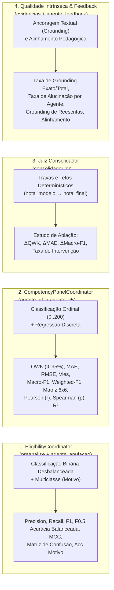

# Guia de Métricas de Machine Learning, Ciência de Dados e AES nos Agentes ENEM

Este documento detalha todas as métricas estatísticas, de **Machine Learning (ML)**, **Ciência de Dados** e **Automated Essay Scoring (AES)** implementadas em `src/enem_corretor/eval/metricas.py` e executadas pelo runner `src/enem_corretor/eval/run_eval.py`.

---

## 1. Visão Geral: Por Que Diferentes Agentes Exigem Diferentes Métricas?

O pipeline do **Corretor ENEM (`CorretorEnemAgent`)** é um sistema multi-agente neuro-simbólico em que cada etapa resolve uma tarefa estatística diferente. Aplicar apenas uma métrica global (como acurácia simples ou apenas erro médio) oculta falhas críticas específicas de cada agente:



---

## 2. Métricas de Classificação Binária — Elegibilidade e Anulação (`EligibilityCoordinator`)

A decisão de anular uma redação (`anulada = True` vs. `False`), tomada em conjunto pelo **Gate 1 Determinístico** (`executar_preanalise`: menos de 8 linhas, folha em branco, cópia massiva) e pelo **Gate 2 Semântico** (`agente_anulacao`: fuga ao tema, tipo textual incorreto, impropérios, identificação), é um problema clássico de **classificação binária desbalanceada**.

> **Por que Acurácia simples não basta aqui?**
> Em conjuntos reais de redações, menos de 5% dos textos são anulados. Um agente que **nunca anula nenhuma redação** teria **95% de acurácia**, mas **0% de Recall**. Por outro lado, um falso positivo de anulação (zerar indevidamente uma redação válida) é o erro mais severo do sistema.

### 2.1. Matriz de Confusão Binária (`matriz_confusao_binaria`)
- **TP (Verdadeiro Positivo):** Redação que deveria ser anulada e foi corretamente anulada.
- **FP (Falso Positivo):** Redação válida que o agente anulou indevidamente (**erro crítico**).
- **TN (Verdadeiro Negativo):** Redação válida que passou normalmente para a correção C1–C5.
- **FN (Falso Negativo):** Redação que deveria ser anulada, mas passou sem ser anulada.

### 2.2. Acurácia e Acurácia Balanceada (`acuracia`, `acuracia_balanceada`)
- **Acurácia:** Proporção global de acertos:
  $$\text{Acurácia} = \frac{TP + TN}{TP + FP + TN + FN}$$
- **Acurácia Balanceada:** Média aritmética entre a **Sensibilidade (TPR / Recall)** e a **Especificidade (TNR)**. Corrige o viés de classes desbalanceadas:
  $$\text{Balanced Accuracy} = \frac{1}{2}\left(\frac{TP}{TP + FN} + \frac{TN}{TN + FP}\right)$$

### 2.3. Precisão, Recall, F1-Score e $F_{0.5}$-Score (`precisao_recall_fbeta`)
- **Precisão (Precision):** Das redações que o agente anulou, quantas realmente deveriam ser anuladas?
  $$\text{Precisão} = \frac{TP}{TP + FP}$$
- **Recall (Sensibilidade):** Das redações que deveriam ser anuladas no dataset, quantas o agente detectou?
  $$\text{Recall} = \frac{TP}{TP + FN}$$
- **F1-Score:** Média harmônica equilibrada entre Precisão e Recall ($\beta = 1.0$):
  $$F_1 = 2 \cdot \frac{\text{Precisão} \cdot \text{Recall}}{\text{Precisão} + \text{Recall}}$$
- **$F_{0.5}$-Score ($\beta = 0.5$):** Métrica principal de decisão para o `agente_anulacao`. Atribui **peso $2\times$ maior à Precisão** do que ao Recall, refletindo a diretriz conservadora do corretor (evitar falsos positivos de anulação):
  $$F_{0.5} = (1 + 0.5^2) \cdot \frac{\text{Precisão} \cdot \text{Recall}}{(0.5^2 \cdot \text{Precisão}) + \text{Recall}} = \frac{1.25 \cdot \text{Precisão} \cdot \text{Recall}}{0.25 \cdot \text{Precisão} + \text{Recall}}$$

### 2.4. Coeficiente de Correlação de Matthews (`mcc_binario`)
- **MCC (Matthews Correlation Coefficient):** Considerada na literatura de Data Science a métrica mais informativa para classificação binária desbalanceada. Varia de $-1$ (discordância total) a $+1$ (classificação perfeita), sendo $0$ equivalente a um palpite aleatório:
  $$\text{MCC} = \frac{TP \cdot TN - FP \cdot FN}{\sqrt{(TP+FP)(TP+FN)(TN+FP)(TN+FN)}}$$

### 2.5. Acurácia do Motivo de Anulação (`acuracia_motivo`)
- Quando a redação possui um `motivo_anulacao` esperado (ex.: `texto_insuficiente`, `fuga_ao_tema`, `tipo_textual`), mede a proporção de casos em que o motivo diagnosticado pelo sistema coincide com o motivo esperado do gabarito.

---

## 3. Métricas dos Agentes de Competência (`agente_c1` a `agente_c5`) e Nota Total

Os 5 agentes especialistas atribuem notas discretas e ordenadas em 6 níveis: `{0, 40, 80, 120, 160, 200}`, cuja soma compõe a `nota_total` (`0` a `1000`). Por isso, combinamos métricas de **Classificação Multiclasse**, **Concordância Ordinal (AES)** e **Regressão/Ranking**.

### 3.1. Classificação Multiclasse por Nível (`metricas_multiclasse`)

LLMs avaliadores frequentemente apresentam **viés de tendência central**: concentram suas predições nos níveis intermediários (`120` e `160`) e têm baixo *Recall* nas pontas (`0`, `40` e `200`). As métricas multiclasse expõem esse comportamento:

- **Precisão, Recall e F1 por Nível (`por_nivel`):** Calcula individualmente o desempenho do agente em cada faixa (`0`, `40`, `80`, `120`, `160`, `200`).
- **Macro-F1 (`macro_f1`):** Média aritmética simples do F1-Score de todas as classes ativas. Como dá o mesmo peso para uma classe rara (ex.: nota `40` ou `200`) e para uma classe frequente (`120`), **cai drasticamente se o agente ignorar notas extremas**.
- **Weighted-F1 (`weighted_f1`):** Média do F1-Score ponderada pelo suporte (número de exemplos reais) de cada nível.
- **Matriz de Confusão $6 \times 6$ (`matriz_confusao`):** Tabela cruzada entre o nível humano (`esperado`) e o nível predito (`obtido`), permitindo identificar se a confusão ocorre entre níveis vizinhos (ex.: `160` vs. `200`) ou distantes.

### 3.2. Métricas Clássicas de AES e Concordância Ordinal

- **QWK — Quadratic Weighted Kappa (`qwk` + `bootstrap_ic95`):** Métrica oficial padrão de benchmarks de correção automática de redações. Mede a concordância entre corretor humano e agente descontando a concordância esperada ao acaso e penalizando erros de forma **quadrática** à distância entre os níveis (errar por 80 pontos é $4\times$ mais grave que errar por 40 pontos):
  $$\kappa = 1 - \frac{\sum_{i,j} w_{ij} O_{ij}}{\sum_{i,j} w_{ij} E_{ij}}, \quad w_{ij} = \frac{(i - j)^2}{(k - 1)^2}$$
  - Referência de interpretação: $\kappa \ge 0.70$ (bom/forte), $\kappa \ge 0.80$ (excelente).
- **Concordância Exata (`concordancia_exata` / Acurácia Multiclasse):** Proporção de redações em que a nota do agente é exatamente igual à nota humana.
- **Concordância Adjacente (`concordancia_adjacente`):** Proporção de redações em que a diferença absoluta é de no máximo 1 nível ($\le 40$ pontos por competência; $\le 80$ pontos na nota total — limite oficial de discrepância aceitável entre dois corretores humanos no ENEM).

### 3.3. Métricas de Regressão e Correlação de Ranking

- **MAE — Erro Médio Absoluto (`mae`):** Média em pontos da distância absoluta entre nota predita e humana:
  $$\text{MAE} = \frac{1}{N} \sum_{i=1}^{N} |\hat{y}_i - y_i|$$
- **RMSE — Raiz do Erro Quadrático Médio (`rmse`):** Penaliza erros grandes (outliers) com maior intensidade:
  $$\text{RMSE} = \sqrt{\frac{1}{N} \sum_{i=1}^{N} (\hat{y}_i - y_i)^2}$$
- **Viés Médio / Bias (`vies_medio`):** Média com sinal de $(\hat{y}_i - y_i)$.
  - $\text{Viés} > 0$: agente **benevolente** (inflaciona notas).
  - $\text{Viés} < 0$: agente **severo** (deflaciona notas).
- **Correlação Linear de Pearson (`correlacao_pearson` — $r$):** Mede a relação linear entre as notas humanas e as notas dos agentes ($r \in [-1, +1]$).
- **Correlação de Postos de Spearman (`correlacao_spearman` — $\rho$):** Mede a **monotonicidade do ranking** (se o agente ordena as redações da pior para a melhor na mesma ordem que os corretores humanos, mesmo que exista um viés constante). Trata empates via postos médios (*average ranks*).
- **Coeficiente de Determinação (`r2_score` — $R^2$):** Proporção da variância das notas reais que é explicada pelas notas do agente:
  $$R^2 = 1 - \frac{\sum_{i=1}^{N} (y_i - \hat{y}_i)^2}{\sum_{i=1}^{N} (y_i - \bar{y})^2}$$

---

## 4. Estudo de Ablação: Agentes LLM Puros vs. Juiz Consolidador (`ablation_consolidador`)

Na arquitetura do projeto, cada agente especialista (`agente_c1`..`agente_c5`) emite uma `nota_modelo`. Em seguida, o **Juiz Consolidador (`consolidar_avaliacao`)** aplica regras determinísticas oficiais do ENEM (ex.: tangenciamento em C2 limita C2/C3/C5 a 40; contagem objetiva dos 5 elementos válidos em C5 = $40 \times N_{\text{válidos}}$; violação aos Direitos Humanos zera C5; cópia $\ge 20\%$ limita C2 a 80).

O runner calcula automaticamente o **efeito causal do Consolidador**:
- **`qwk_modelo` vs. `qwk_pos_consolidador` ($\Delta\text{QWK}$):** Ganho de QWK proporcionado pelas travas determinísticas ($\Delta\text{QWK} > 0$ indica que o consolidador corrigiu alucinações de nota do LLM).
- **`mae_modelo` vs. `mae_pos_consolidador` ($\Delta\text{MAE}$):** Redução do erro médio absoluto ($\Delta\text{MAE} < 0$ indica redução de erro).
- **`macro_f1_modelo` vs. `macro_f1_pos_consolidador` ($\Delta\text{Macro-F1}$):** Ganho de classificação por nível.
- **`taxa_intervencao`:** Percentual de redações em que o consolidador precisou alterar a nota original dada pelo agente LLM. Uma taxa de intervenção muito alta em determinada competência (ex.: C5) sinaliza que o prompt daquele agente pode ser melhor calibrado.

---

## 5. Métricas de Qualidade Intrínseca de Agentes LLM (Sem Necessidade de Gabarito Humano)

Mesmo em produção (quando não há nota humana de referência), é possível medir a qualidade técnica e a confiabilidade dos agentes LLM:

### 5.1. Grounding e Taxa de Alucinação de Evidências (`metricas_grounding_evidencias`)
Todos os agentes `C1` a `C5` são obrigados a justificar suas avaliações citando trechos literais da redação (`evidencias`, `desvios`, `repertorios`, `argumentos`, `inadequacoes`, `elementos`). O módulo `tools/evidencias.py` classifica cada citação em `exata`, `aproximada` ou `nao_encontrada`. A partir disso, calculamos globalmente e **por agente individual (`agente_c1`..`agente_c5`)**:
- **Taxa de Grounding Exato (`taxa_grounding_exato`):** $\frac{\text{exata}}{\text{total}}$
- **Taxa de Grounding Total / Faithfulness (`taxa_grounding_total`):** $\frac{\text{exata} + \text{aproximada}}{\text{total}}$ (meta recomendada: $\ge 0.95$)
- **Taxa de Alucinação de Citação (`taxa_alucinacao`):** $\frac{\text{nao\_encontrada}}{\text{total}}$ (meta recomendada: $\le 0.05$)

### 5.2. Qualidade do Agente de Feedback (`avaliar_qualidade_feedback`)
Avalia automaticamente a saída estruturada do `agente_feedback`:
- **Grounding de Reescritas (`taxa_grounding_reescritas`):** Proporção de exemplos em `feedback.reescritas` cujo `trecho_original` realmente existe na redação do aluno.
- **Alinhamento Pedagógico de Prioridades (`alinhamento_prioridades`):** Proporção de itens em `feedback.prioridades` que apontam para competências com defasagem real (nota $< 200$ e situadas até 1 nível acima da menor nota da redação). Evita que o agente sugira priorizar uma competência em que o aluno já tirou 200 enquanto outra competência ficou com 80 ou 120.

### 5.3. Confiabilidade Operacional e SLA (`qualidade_agentes`)
- **Taxa de Completude (`taxa_completude`):** Proporção de redações avaliadas do início ao fim sem falha técnica em nenhum sub-agente (`incompleta == False`).
- **Percentis de Latência (`percentil`):** Tempo de resposta médio e percentis $P_{50}$ (mediana), $P_{90}$ e $P_{95}$ em milissegundos.

---

## 6. Como Executar e Inspecionar as Métricas

### 6.1. Executar avaliação completa sobre um dataset `.jsonl`
```bash
uv run enem-corretor-eval \
  --dataset data/exemplos/stress_set_amostra.jsonl \
  --out runs/avaliacao_completa
```

### 6.2. Recalcular métricas de um `results.jsonl` existente (Offline, sem chamadas de LLM)
```bash
uv run enem-corretor-eval \
  --recalcular-de runs/baseline_refactor/results.jsonl \
  --out runs/baseline_refactor
```

### 6.3. Artefatos Gerados no Diretório `--out`
- `results.jsonl`: Log linha a linha contendo `esperado`, `obtido`, `obtido_modelo`, `intervencoes_consolidador`, `evidencias_por_agente`, `qualidade_feedback` e `latencia_ms`.
- `metrics.json`: Objeto JSON completo com todas as métricas de classificação, regressão, matrizes de confusão $6 \times 6$, estudo de ablação e qualidade intrínseca, pronto para consumo em notebooks ou dashboards.
- `report.md`: Relatório executivo em Markdown com tabelas formatadas para todas as 4 dimensões de análise.
