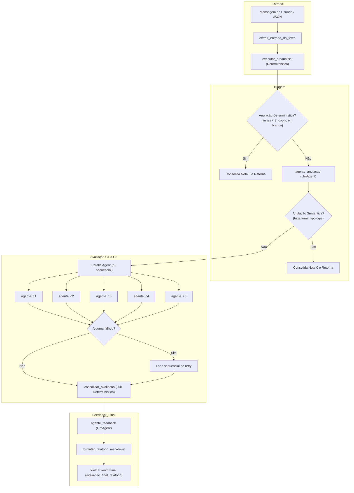

# 01 — Auditoria dos Agentes Atuais

> **Data da Auditoria:** 2026-11-07  
> **Escopo:** Mapeamento da arquitetura atual (`src/enem_corretor/agents/`), catálogo de responsabilidades, dependências de session state, análise de acoplamento e diagnóstico de problemas arquiteturais.

---

## 1. Mapeamento dos Agentes e Componentes Atuais

O sistema atual é orquestrado por uma classe personalizada derivada de `google.adk.agents.BaseAgent` (`CorretorEnemAgent`), que gerencia uma coleção de agentes folha (`LlmAgent`), um agregador paralelo (`ParallelAgent`) e rotinas determinísticas em Python.

### Tabela de Agentes e Componentes

| Nome / Identificador | Arquivo Fonte | Tipo no Google ADK | Responsabilidade Principal | Ferramentas / Callbacks | Chaves Lidas do State | Chaves Gravadas no State | Chamadas LLM |
|---|---|---|---|---|---|---|---:|
| **`CorretorEnemAgent`** | `agents/orquestrador.py` | `BaseAgent` | Orquestração central de todo o ciclo de vida, gerenciamento de retentativas, fallback, encerramento antecipado e formatação final | `_salvar_execucao_jsonl` | `entrada`, `preanalise`, `anulacao_llm`, `avaliacao_c1`..`c5`, `feedback` | `entrada`, `preanalise`, `avaliacao_consolidada`, `avaliacao_final`, `relatorio_markdown` | 0 (orquestrador puro) |
| **`executar_preanalise`** | `agents/preanalise.py` | Função pura (determinística) | Contagem de linhas/palavras, detecção de cópia de motivadores, análise de conectivos e verificação gramatical inicial | `texto.py`, `copia.py`, `conectivos.py`, `gramatica.py` | (Recebe `EntradaRedacao`) | `preanalise` | 0 |
| **`agente_anulacao`** | `agents/anulacao.py` | `LlmAgent` | Avaliação semântica de anulação (fuga total ao tema, não atendimento ao tipo textual, partes desconectadas, identificação do participante) | `callback_contexto_redacao(incluir_avaliacao=False)` | `entrada`, `preanalise` (via callback) | `anulacao_llm` (`ResultadoAnulacao`) | 1 |
| **`avaliadores_competencias`** | `agents/orquestrador.py` | `ParallelAgent` | Execução concorrente dos avaliadores C1 a C5 (desativável via `cfg.paralelo=False`) | `sub_agents=[agente_c1, ..., agente_c5]` | N/A (delega aos sub-agentes) | N/A (sub-agentes gravam) | 0 (orquestrador paralelo) |
| **`agente_c1`** | `agents/competencias.py` | `LlmAgent` | Avaliação da norma culta formal (desvios gramaticais e estrutura sintática) | `callback_contexto_redacao`, rubrica `c1.yaml` | `entrada`, `preanalise` | `avaliacao_c1` (`ResultadoC1`) | 1 (+ retries) |
| **`agente_c2`** | `agents/competencias.py` | `LlmAgent` | Avaliação do tema, tipologia dissertativa-argumentativa e repertório sociocultural | `callback_contexto_redacao`, rubrica `c2.yaml` | `entrada`, `preanalise` | `avaliacao_c2` (`ResultadoC2`) | 1 (+ retries) |
| **`agente_c3`** | `agents/competencias.py` | `LlmAgent` | Avaliação de projeto de texto, autoria e consistência dos argumentos | `callback_contexto_redacao`, rubrica `c3.yaml` | `entrada`, `preanalise` | `avaliacao_c3` (`ResultadoC3`) | 1 (+ retries) |
| **`agente_c4`** | `agents/competencias.py` | `LlmAgent` | Avaliação da coesão inter e intraparágrafo e repertório de conectivos | `callback_contexto_redacao`, rubrica `c4.yaml` | `entrada`, `preanalise` | `avaliacao_c4` (`ResultadoC4`) | 1 (+ retries) |
| **`agente_c5`** | `agents/competencias.py` | `LlmAgent` | Avaliação da proposta de intervenção (5 elementos) e respeito aos Direitos Humanos | `callback_contexto_redacao`, rubrica `c5.yaml` | `entrada`, `preanalise` | `avaliacao_c5` (`ResultadoC5`) | 1 (+ retries) |
| **`consolidar_avaliacao`** | `agents/consolidador.py` | Função pura (determinística) | Juiz determinístico: teto de tangenciamento (C2/C3/C5), contagem estrita de 5 elementos (C5), teto de cópia e validação literal de evidências | `evidencias.py`, `rubricas.py` | `entrada`, `preanalise`, `anulacao_llm`, `avaliacao_c1`..`c5` | `avaliacao_consolidada` | 0 |
| **`agente_feedback`** | `agents/feedback.py` | `LlmAgent` | Geração pedagógica de plano de melhoria, prioridades, exemplos de reescrita e checklist | `callback_contexto_redacao(incluir_avaliacao=True)` | `entrada`, `preanalise`, `avaliacao_consolidada` | `feedback` (`Feedback`) | 1 |
| **`formatar_relatorio_markdown`** | `agents/consolidador.py` | Função pura | Formata o objeto consolidado final em Markdown completo para o aluno | N/A | (Recebe `AvaliacaoFinal`) | `relatorio_markdown` | 0 |

---

## 2. Diagrama do Fluxo Atual (As-Is)

---

## 3. Diagnóstico de Problemas Arquiteturais (Code Smells e Riscos)

### 3.1 "God Orchestrator" (`CorretorEnemAgent`)
- **Problema:** A classe `CorretorEnemAgent` em `src/enem_corretor/agents/orquestrador.py` (287 linhas) centraliza responsabilidades excessivas:
  1. Parsing de strings de texto da interface do usuário.
  2. Execução da pré-análise determinística.
  3. Gerenciamento do ciclo de vida assíncrono via `Aclosing(agent.run_async(ctx))`.
  4. Lógica de curto-circuito condicional.
  5. Lógica manual de retentativa (`for tentativa in range(self._cfg.tentativas_competencia)`).
  6. Invocação do juiz consolidador de regras de negócio.
  7. Parsing do feedback com fallback silencioso.
  8. Gravação de arquivos no sistema operacional (`historico.jsonl`).
  9. Montagem dos eventos finais do ADK.
- **Risco:** Qualquer alteração em uma etapa de negócios afeta todo o orquestrador, dificultando a manutenção e testes isolados.

### 3.2 "Chaves Mágicas" Soltas no Session State
- **Problema:** A comunicação entre agentes é feita através de literais de string distribuídos no código (`"entrada"`, `"preanalise"`, `"anulacao_llm"`, `"avaliacao_c1"`, etc.).
- **Risco:** Erros de digitação (`"avaliacao_c_1"`) não causam erro de compilação nem de importação, falhando silenciosamente em runtime com `None`.

### 3.3 Falta de Contratos Tipados de Estado Intermediário
- **Problema:** Ao ler valores do `ctx.session.state.get(...)`, o código faz verificações ad-hoc como `if isinstance(valor, dict) and "nota" in valor:`.
- **Risco:** Não há garantia em tempo de compilação ou de linting sobre a estrutura de dados esperada em cada etapa da esteira.

### 3.4 Deprecation Warning do `ParallelAgent` no Google ADK
- **Problema:** No Google ADK `2.13.0`, `ParallelAgent` emite um aviso formal de depreciação recomendando o uso de padrões sequenciais ou workflows gerenciados. No código atual, esse aviso é mascarado com `warnings.catch_warnings()`.
- **Risco:** Incompatibilidade com versões futuras do ADK e potencial quebra silenciosa se o ADK descontinuar a classe.

### 3.5 Acoplamento no Callback de Contexto (`comum.py`)
- **Problema:** `callback_contexto_redacao` em `agents/comum.py` é responsável por injetar o prompt do usuário sanitizado em XML diretamente no objeto `LlmRequest` antes de cada chamada. No entanto, ele lê diretamente do dicionário do state (`callback_context.state.to_dict()`) com chaves fracamente tipadas.

### 3.6 Testabilidade dos Agentes em Isolamento
- **Problema:** Para testar a lógica de retentativa ou a lógica de anulação, é necessário simular o fluxo assíncrono completo do `BaseAgent` ou usar mocks pesados de `InvocationContext` e `Runner`.

---

## 4. Oportunidades Identificadas para a Refatoração

1. **Definição formal de `state_keys.py`**: Criar constantes tipadas e modelos de payload para o Session State.
2. **Separação em Sub-agentes e Coordenadores Especializados**:
   - `EligibilityCoordinator`: Coordena pré-análise e anulação semântica, isolando o curto-circuito.
   - `CompetencyPanelCoordinator`: Coordena a avaliação C1–C5 com fallback, validação individual de schema e retentativa isolada.
   - `ConsolidationCoordinator`: Componente determinístico isolado para regras de teto e validação de evidências.
   - `FeedbackCoordinator`: Agente especializado no feedback acionável condicionado à avaliação prévia.
3. **Preservação rigorosa da interface pública**: A assinatura externa (`root_agent`, `corrigir_redacao`, `corrigir_redacao_async`, `criar_corretor_agent`) e todas as 12 regras de domínio (R-01 a R-12) permanecem estritamente idênticas.
