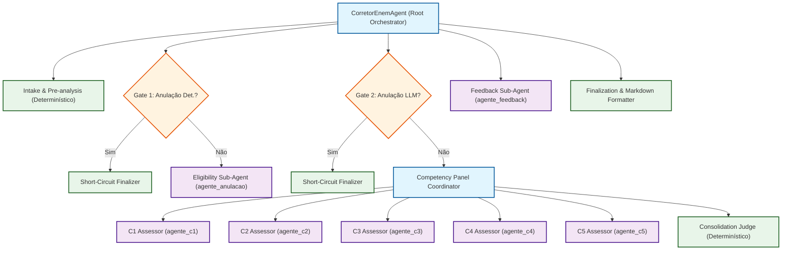
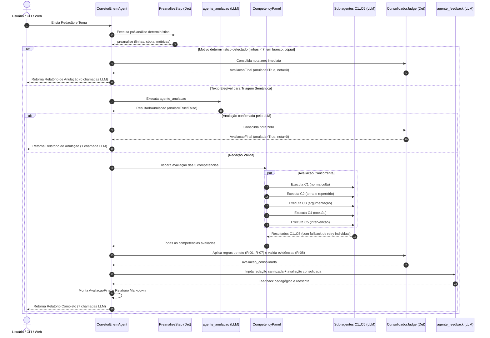

# 02 — ADR: Arquitetura de Agentes e Sub-agentes do Corretor ENEM

> **Status:** Proposta (Aguardando Aprovação)  
> **Data:** 2026-11-07  
> **Decisores:** Arquiteto de Software & Engenharia de Qualidade  
> **Referência Técnica:** Google ADK `2.13.0`, INEP Guia de Redação do ENEM

---

## 1. Contexto e Motivação

O corretor de redações do ENEM foi construído sobre o Google ADK (`google-adk==2.13.0`) com uma classe orquestradora personalizada (`CorretorEnemAgent`) que agrupa chamadas a ferramentas determinísticas e agentes LLM.

A auditoria arquitetural (`docs/refactor/01-auditoria.md`) identificou oportunidades cruciais de melhoria:
1. **Acoplamento excessivo no orquestrador**: A classe `CorretorEnemAgent` acumula parsing de texto, pré-análise determinística, gerenciamento de eventos assíncronos, curto-circuito condicional, loops de retry, juiz de regras de teto e escrita de arquivos em disco.
2. **Ausência de contratos formais de estado**: A troca de dados depende de literais de string distribuídos (`"entrada"`, `"preanalise"`, `"avaliacao_c1"`, etc.), aumentando o risco de regressões e falhas silenciosas.
3. **Depreciação de primitivas do ADK**: O uso de `ParallelAgent` gera alertas de depreciação na versão 2.13.0, demandando uma estratégia flexível de execução concorrente e sequencial.
4. **Necessidade de testes isolados**: É imperativo testar cada sub-agente e cada gate determinístico isoladamente, sem precisar instanciar a esteira completa.

---

## 2. Princípios de Decisão: Sub-agente vs. Ferramenta vs. Função Pura

Para evitar a proliferação desnecessária de agentes (anti-padrão comum em sistemas LLM), adotamos critérios formais baseados na especificação do Google ADK:

### 2.1 Quando um Sub-agente DEVE ser criado
1. **Especialização cognitiva e rubrica própria:** A tarefa exige julgamento qualitativo com base em critérios conceituais distintos do INEP (ex.: Competência 1 foca em norma culta gramatical; Competência 2 foca em tema, tipologia e repertório).
2. **Isolamento de contexto:** A tarefa requer proteção contra contaminação por outras avaliações (o avaliador de C1 não deve ser enviesado pelas teses de C3 nem pela intervenção de C5).
3. **Contrato de saída tipado e independente:** A tarefa produz um artefato intermediário autônomo com validação estrita de schema Pydantic (`ResultadoC1`, `ResultadoC2`, etc.).
4. **Isolamento de falhas e resiliência:** A falha de um sub-agente deve permitir retentativa individual sem reexecutar os demais.

### 2.2 Quando um Sub-agente NÃO DEVE ser criado (usar função determinística)
1. **Lógica 100% algorítmica:** Contagem de linhas, palavras, correspondência exata de substrings, similaridade de n-gramas e regex (ex.: pré-análise de cópia e linhas estimadas).
2. **Aplicação de regras formais de edital (tetos e penalidades):** Regras do INEP que impõem nota máxima por tangenciamento, contagem objetiva dos 5 elementos de C5 e desconto por cópia são regras matemáticas exatas.
3. **Validação literal de citações:** Verificação se os trechos citados pelo LLM existem de fato no texto da redação (tarefa determinística de busca de substring e Levenshtein).
4. **Geração e formatação de texto derivado:** Montagem do relatório Markdown final e serialização JSONL.

---

## 3. Comparação de Alternativas Arquiteturais

Avaliamos três alternativas estruturais para a organização dos agentes:

```
+------------------------------------------------------------------------------------------------+
| Alternativa A (Recomendada): Hierarquia Modular de Sub-agentes com Gates Determinísticos      |
| Alternativa B: Agente Monolítico de Chamada Única ou Sequencial Pura (Lean)                    |
| Alternativa C: Decomposição Ultra-Granular Multi-Passo por Sub-tarefa Interna                  |
+------------------------------------------------------------------------------------------------+
```

### 3.1 Alternativa A (Recomendada): Hierarquia Modular com Painel de Competências e Gates Determinísticos
- **Estrutura:**
  - Orquestrador Raiz (`CorretorEnemAgent`) coordena as fases.
  - Fase 1: `EligibilityCoordinator` (Gate Determinístico de Linhas/Cópia + Sub-agente `agente_anulacao` com curto-circuito).
  - Fase 2: `CompetencyPanelCoordinator` (Painel com 5 sub-agentes `agente_c1`..`agente_c5`, com isolamento de contexto e fallback de retentativa individual).
  - Fase 3: `ConsolidationJudge` (Módulo determinístico que aplica os limites do edital e validação de evidências).
  - Fase 4: `FeedbackCoordinator` (Sub-agente `agente_feedback` condicionado às notas consolidadas).
  - Fase 5: `FinalizationStep` (Montagem de `AvaliacaoFinal` e Markdown).
- **Prós:**
  - Máxima fidelidade pedagógica às 5 rubricas do INEP.
  - Orçamento estrito de chamadas: **0** (anulação det.), **1** (anulação semântica) e **7** (fluxo completo).
  - Cada competência pode ser mockada e testada isoladamente com contratos tipados.
  - Atende plenamente aos 12 requisitos de domínio (R-01 a R-12).
- **Contras:** Exige orquestração cuidadosa de eventos no Google ADK.

### 3.2 Alternativa B: Agente Monolítico de Chamada Única / Sequencial Lean
- **Estrutura:** Um único `LlmAgent` recebe a redação e um prompt com todas as 5 competências consolidadas, gerando todo o JSON de uma vez.
- **Prós:** Apenas 1 chamada a LLM; código de orquestração mínimo.
- **Contras:**
  - **Severa degradação da acurácia e calibração:** LLMs falham em prestar atenção uniforme a dezenas de níveis de 5 rubricas complexas ao mesmo tempo ("lost in the middle").
  - Impossibilidade de retentar apenas a competência que divergiu ou falhou no schema.
  - Alto risco de alucinação de evidências e notas descalibradas.
  - Incompatível com o modelo mental do INEP (dois corretores humanos independentes por competência).

### 3.3 Alternativa C: Decomposição Ultra-Granular Multi-Passo
- **Estrutura:** Cada competência é decomposta em 2 a 3 sub-agentes encadeados (ex.: C1_ExtraiDesvios -> C1_ClassificaNivel; C5_ValidaAcao -> C5_ValidaAgente -> C5_CalculaNota).
- **Prós:** Especialização microscópica de cada tarefa.
- **Contras:**
  - Explosão no número de chamadas de LLM: **15 a 25 chamadas por redação**.
  - Viola o orçamento para APIs gratuitas (exaustão rápida de RPM/TPM no Gemini e latência inaceitável em modelos locais no Ollama).
  - Latência total superior a 60 segundos por redação.

### 3.4 Matriz de Decisão Comparativa

| Critério de Avaliação | Alternativa A (Hierarquia Modular) | Alternativa B (Monolítico Lean) | Alternativa C (Ultra-Granular) |
|---|:---:|:---:|:---:|
| **Fidelidade às Rubricas do INEP** | **Excelente (Alta)** | Baixa | Alta |
| **Chamadas LLM (Caminho Feliz)** | **7** | **1** | 18–25 |
| **Chamadas LLM (Anulação Det.)** | **0 (Curto-circuito)** | 1 | 0 |
| **Latência Média Estimada** | **~10–18s** (paralelo) | ~8–12s | > 60s |
| **Compatibilidade c/ APIs Gratuitas** | **Excelente** | Excelente | Inviável |
| **Testabilidade e Depurabilidade** | **Excelente** | Baixa | Complexa |
| **Isolamento de Falhas (Retry Unitário)** | **Sim (por competência)** | Não (tudo ou nada) | Sim (micro-etapas) |
| **Decisão** | **SELECIONADA** | Descartada | Descartada |

---

## 4. Diagrama da Arquitetura-Alvo (Target Architecture)

### 4.1 Composição Hierárquica de Componentes



### 4.2 Diagrama de Sequência de Execução com Gates



---

## 5. Matriz de Conformidade com Regras de Domínio (R-01 a R-12)

| Regra | Descrição no Edital do ENEM | Componente Responsável na Nova Arquitetura |
|---|---|---|
| **R-01** | Notas estritas em `{0, 40, 80, 120, 160, 200}` | `SCHEMAS_COMPETENCIA` + `ajustar_nivel` no `ConsolidationJudge` |
| **R-02** | Se anulada, nota total é 0 e todas as 5 competências recebem 0 | `ConsolidationJudge` em curto-circuito |
| **R-03** | Curto-circuito determinístico sem chamadas LLM para textos < 7 linhas | `Intake & Pre-analysis` + Gate 1 |
| **R-04** | Violação aos Direitos Humanos zera apenas a C5 (não anula a redação toda) | `ConsolidationJudge` |
| **R-05** | Tangenciamento ao tema limita C2 a 40 pontos e teto em C3 e C5 | `ConsolidationJudge` |
| **R-06** | Cópia de textos motivadores limita C2 a no máximo 80 pontos | `ConsolidationJudge` |
| **R-07** | Contagem objetiva dos 5 elementos formais em C5 (0 a 5 presentes) | `ConsolidationJudge` |
| **R-08** | Validação literal de evidências citadas pelo LLM contra o texto original | `tools/evidencias.py` integrado no `ConsolidationJudge` |
| **R-09** | Desconto de linhas copiadas no cálculo de linhas válidas | `tools/copia.py` no `Intake` determinístico |
| **R-10** | Isolamento de prompt injection via delimitadores XML no `before_model_callback` | `agents/comum.py` (`callback_contexto_redacao`) |
| **R-11** | Sanitização contra escape de tags XML (`</redacao>`, etc.) | `sanitizar_delimitadores_xml` em `agents/comum.py` |
| **R-12** | Resiliência com fallback e retry individual por competência | `CompetencyPanelCoordinator` |

---

## 6. Conclusão da Decisão Arquitetural

A **Alternativa A** reúne o melhor equilíbrio entre modularidade, fidelidade pedagógica ao INEP, controle rígido de custos/chamadas de LLM e testabilidade isolada. A transição será realizada de forma incremental, garantindo que em nenhuma etapa os testes quebrem.
